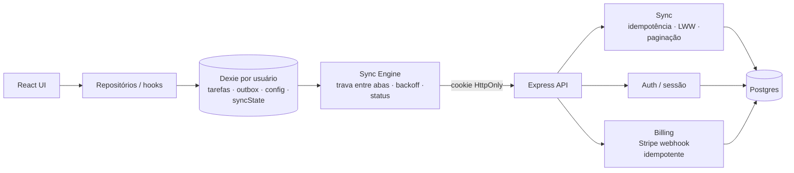

# Estudo comparativo e plano de evolução do `app_base`

> Estudo feito por leitura dos dois projetos em `estudo_0/`.
> O objetivo **não é reescrever** o `app_base`, e sim portar seletivamente o que o
> `modelo_base` resolve melhor (segurança, sincronização, armazenamento e
> confiabilidade), preservando o que o `app_base` já tem de mais valioso:
> assinaturas com Stripe, lixeira com restauração, banco local por usuário e as
> telas de agenda/progresso.

---

## 1. Resumo executivo

- O **`modelo_base`** é uma referência de **infraestrutura offline-first**:
  sessão em cookie, CSP, validação Zod compartilhada, sync com idempotência,
  relógio limitado, paginação, cota de armazenamento, backup versionado e testes.
- O **`app_base`** é um **produto mais completo em negócio**: tarefas, lixeira
  com retenção de 3 dias, agenda, progresso, onboarding, QR code e cobrança
  Stripe com plano Free/Pro.
- O `app_base` tem três riscos que precisam de atenção antes de qualquer nova
  feature:
  1. **Troca de conta durante o sync** pode misturar/apagar dados entre contas.
  2. **Autenticação** com JWT em `localStorage`, 30 dias, sem revogação, CORS
     aberto e sem rate-limit/headers de segurança.
  3. **Confiança em timestamps do cliente** (`atualizada_em` e `lixeira_em`) e
     **pull sem paginação**, o que permite travar o LWW, expurgar cedo demais ou
     derrubar o servidor com uma conta grande.
- A estratégia recomendada é incremental, em 5 fases, sem trocar Express/JS/SQL
  por Hono/TS/Prisma de uma vez.
- O maior ganho vem da **Fase 0 + Fase 1**: fecha riscos de segurança e o bug de
  troca de conta, sem alterar o modelo de produto.

---

## 2. O que cada projeto tem hoje

### 2.1 `modelo_base` — referência de infraestrutura

**Stack:** Vite + React 19 + TypeScript + Dexie no cliente; Hono + Prisma 7 +
Postgres + better-auth no servidor; Zod compartilhado; Vitest; Docker; CI.

**Fluxo principal**

```text
UI → repositório → Dexie (registro + outbox na MESMA transação)
     → syncEngine → POST /api/sync/push → Prisma
     → GET /api/sync/pull  → Dexie
```

**Pontos fortes**

| Área | O que faz |
|---|---|
| Offline-first | CRUD 100% local; outbox com payload; compactação por registro; retry com backoff exponencial (2 s → 5 min). |
| Sync | Idempotência por `mutacao.id`; LWW por `updatedAt`; relógio limitado (5 min no futuro, 90 dias no passado); tombstones protegidos; `serverSeq` por usuário; transação + lock da linha do usuário. |
| Conta | better-auth, sessão em cookie HttpOnly, revogação consultada no banco a cada sync, troca/recuperação de senha, rate-limit em produção. |
| Segurança | CSP estrita, HSTS/upgrade quando HTTPS, `X-Frame-Options: DENY`, `Referrer-Policy: no-referrer`, COOP/CORP, `bodyLimit` de 2 MB, Zod em todo payload. |
| Armazenamento | `storage.persist()`, estimativa de cota, alerta em 80%, erro de cota tratado, limpeza de tombstones/registros antigos, “baixar tudo de novo”. |
| Backup | Exportar/importar JSON com `app`, `schemaVersion`, data e validação Zod; modos mesclar/substituir. |
| PWA | Instalável, update com prompt (não troca sozinho), aviso “pronto para offline”, modal manual no iOS. |
| Qualidade | Testes com Vitest + `fake-indexeddb`, CI, Docker multi-stage, migrations Prisma, env validado com Zod. |
| Multiconta/multitab | Trava de troca de conta + geração de sync + Web Locks entre abas. |

**Limitações conhecidas do modelo:** não tem billing, lixeira com restauração,
agenda/progresso nem banco separado por usuário; a recuperação de senha depende
de SMTP; iOS não tem background sync nem `storage.persist()`.

### 2.2 `app_base` — produto de tarefas

**Stack:** Vite + React 19 + JavaScript + Dexie no cliente; Express 5 + `pg` +
Stripe no servidor; JWT próprio (HMAC-SHA256); PWA com `vite-plugin-pwa`.

**Fluxo principal**

```text
UI → repo.js → Dexie (tarefa + outbox)
     → sync.js → POST /sync/push → SQL (advisory lock por usuário)
     → GET /sync/pull  → Dexie
```

**Pontos fortes que devem ser preservados**

| Área | O que faz |
|---|---|
| Isolamento local | Um banco IndexedDB por usuário (`MeuBancoV2-<userId>`) — mais seguro contra mistura acidental que o banco global do modelo. |
| Lixeira | Retenção de 3 dias, restauração, expurgo no cliente e no servidor, tombstone definitivo. |
| Produto | Agenda, progresso, busca, fixar, onboarding, QR code, planos, checkout/portal Stripe. |
| Servidor | SQL parametrizado, `scrypt` + `timingSafeEqual`, mensagem genérica no login + hash falso para não revelar e-mail, transação no push, lock por usuário, condição de tombstone no upsert. |
| Offline | Pull antes do push para que exclusões definitivas cheguem primeiro; transações no Dexie; fila local. |

**Lacunas em relação ao modelo**

| Área | `modelo_base` | `app_base` hoje |
|---|---|---|
| Sessão | Cookie HttpOnly + tabela de sessão + revogação | JWT em `localStorage`, 30 dias, sem revogação |
| CORS/headers | Restrito + CSP + HSTS | `cors()` aberto, sem CSP/helmet |
| Validação | Zod compartilhado | Validação manual, servidor confia no formato |
| Relógio | Limitado pelo servidor | `atualizada_em` e `lixeira_em` do cliente são autoridade |
| Idempotência | `sync_mutation` por mutação | Sem tabela; retry depende do LWW/upsert |
| Pull | `cursor` + `limit` + `temMais` | Tudo desde `desde`, sem limite |
| Retry | Backoff + limite de tentativas | Sem backoff, sem limite, intervalo fixo de 30 s |
| Multiconta | Trava/generation/Web Locks | Sem trava; sync pode sobreviver à troca de conta |
| Cota | Persistência, estimativa, alerta, limpeza | Nada |
| Backup | Exportar/importar validado | Nada |
| PWA | Update com prompt | `autoUpdate` (troca sozinho) |
| Migrations | Prisma | DDL em tempo de request (`create table if not exists`) |
| Testes/CI/Docker | Sim | Não |
| Billing | Não tem | Sim, mas webhook sem idempotência/ordem |

---

## 3. Riscos encontrados (com evidência)

### P0 — corrigir antes de crescer

1. **Troca de conta no meio do sync pode misturar ou apagar dados.**
   `src/db.js` exporta `db` como binding mutável; `src/sync.js` usa esse binding
   depois de cada `await`. Se o usuário sair/entrar enquanto um sync está em
   andamento, o `pull` pode gravar registros da conta A no banco da conta B e o
   `push` pode apagar entradas da outbox da conta B (os `seq` começam em 1 nas
   duas). Não existe `pausarSync`, geração de sync nem verificação de que o
   banco/token continuam os mesmos.
2. **JWT em `localStorage` por 30 dias, sem revogação.**
   `src/auth.js` guarda o token em `localStorage`; `server/auth/tokens.js` assina
   um JWT sem `jti`/tabela de sessão; trocar a senha não invalida tokens antigos;
   não há logout no servidor. Qualquer XSS rouba a sessão inteira.
3. **CORS aberto + ausência de rate-limit e headers.**
   `server/app.js` chama `cors()` sem origem; não há CSP, HSTS, `nosniff`,
   `frame-ancestors` nem limite de tentativas em `/auth/login` e `/auth/register`.
4. **Servidor confia no relógio do cliente.**
   `server/sync/routes.js` grava `atualizada_em` e `lixeira_em` vindos do
   cliente. Um relógio no futuro vence o LWW para sempre; um `lixeira_em` no
   passado faz o expurgo imediato; no futuro impede a limpeza. O modelo limita
   esse intervalo e trata o expurgo no servidor.
5. **Pull sem paginação e sem limite.**
   `GET /sync/pull` retorna todas as linhas desde `desde`; uma conta grande
   pode gerar resposta enorme, travar o aparelho e consumir memória do servidor.
   Também não há validação de `desde` (negativo, `Infinity`, lixo).

### P1 — confiabilidade e operação

6. **Sem idempotência de mutação.** Um push que chega ao servidor mas perde a
   resposta é reenviado; o upsert é quase idempotente, mas o `servidor_em`
   avança e o cliente rebaixa a mesma tarefa. Não há como devolver o resultado
   exato de uma mutação já aplicada.
7. **Sem backoff, timeout ou limite de tentativas no cliente.** `useSync` chama
   `sincronizar` a cada 30 s; se o servidor estiver fora, martela sem parar.
   `fetch` não tem timeout; um request pendurado deixa `rodando = true` para
   sempre.
8. **Cursor “congelado” por mutação pendente.** Em `src/sync.js`, se qualquer
   registro tiver mutação pendente, `ultimoSync` não avança; o próximo pull
   baixa de novo tudo desde o cursor antigo. Sem limite de tentativas, uma
   mutação que nunca é aceita causa re-download infinito.
9. **Exclusão permanente sem timestamp/LWW.** A operação `delete` do servidor é
   incondicional (`update ... where id and user_id`). Um aparelho offline com
   uma exclusão antiga pode apagar uma tarefa que outro aparelho restaurou
   depois. Como o cliente também expurga a lixeira por relógio local, o risco
   aumenta.
10. **Sem tratamento de cota.** `src/repo.js` não captura `QuotaExceededError`;
    a UI não avisa que a alteração não foi salva. Não há `storage.persist()`
    nem estimativa de uso.
11. **Sem backup/importação/limpeza.** Não há exportar/importar, nem remoção de
    dados já sincronizados, nem “baixar tudo de novo”.
12. **DDL em tempo de request.** `garantirTabelaUsuarios`,
    `garantirColunaLixeira` e `garantirTabelaAssinaturas` criam/alteram tabelas
    na primeira chamada. Isso dificulta deploy, auditoria, rollback e
    permissões de banco. O README manda criar as tabelas manualmente — frágil.
13. **Stripe sem idempotência/ordem de eventos.** `server/billing/webhook.js`
    não registra `event.id`; eventos duplicados ou fora de ordem podem regredir
    o plano (um `updated` antigo depois de um `deleted`, por exemplo).
14. **Limite do plano só no cliente.** O README assume isso; um cliente
    modificado cria tarefas ilimitadas de graça.

### P2 — qualidade e privacidade

15. **Dados locais permanecem após logout.** O banco por usuário fica no
    aparelho; em dispositivo compartilhado isso é retenção indevida. Falta uma
    opção “apagar dados deste usuário neste aparelho”.
16. **Estado de “fixadas” é só de memória.** `TaskApp.jsx` guarda `fixadas` em
    `useState`; recarregar perde tudo.
17. **PWA `autoUpdate`.** Pode trocar o bundle no meio de uma escrita; o modelo
    usa prompt e deixa o usuário decidir.
18. **Sem testes, CI, Docker, health check, shutdown gracioso ou logs
    estruturados.** Erros de rede viram `console.warn` e a UI não mostra o
    estado real do sync.
19. **Sem recuperação de senha, verificação de e-mail ou exclusão de conta.**
20. **Tokens/tombstones crescem sem GC no servidor.** `tarefas` com
    `deletado_em` nunca são removidas; não há tabela de mutações, mas o modelo
    teria o mesmo problema se não limpasse.

---

## 4. Arquitetura-alvo do `app_base`



**Princípios**

- A UI nunca fala com Dexie diretamente: todo acesso passa por repositórios.
- Toda escrita local grava **registro + outbox na mesma transação** (o app_base já
  faz isso; manter).
- O servidor é autoridade de tempo, retenção e status de assinatura; o relógio
  do cliente é só dica.
- Sessão em cookie HttpOnly same-origin; nenhum segredo no bundle.
- Migrations rodam no deploy, nunca no request.
- O app continua utilizável offline; a UI sempre mostra o que está pendente,
  falhou ou foi reconciliado.
- Banco local por usuário (vantagem atual) + opção explícita de apagar dados
  locais.

---

## 5. Especificação das melhorias

### 5.1 Segurança (Fase 0 e 1)

#### a) Validar ambiente no boot

Criar `server/env.js` com Zod (ou validação equivalente), falhando rápido:

```js
const env = {
  NODE_ENV: z.enum(['development', 'production', 'test']).default('development'),
  DATABASE_URL: z.string().min(1),
  JWT_SECRET: z.string().min(32),
  APP_URL: z.string().url().default('http://localhost:5173'),
  PORT: z.coerce.number().int().positive().default(3001),
  STRIPE_SECRET_KEY: z.string().optional(),
  STRIPE_WEBHOOK_SECRET: z.string().optional(),
  STRIPE_PRICE_PRO_MONTHLY: z.string().optional(),
  STRIPE_PRICE_PRO_YEARLY: z.string().optional(),
}
```

- Nunca iniciar em produção sem `JWT_SECRET` e `DATABASE_URL`.
- Nunca usar segredo default.
- Documentar rotação de segredo (invalida sessões).

#### b) Headers e CSP

Adicionar `helmet` ou um middleware próprio (como `modelo_base/server/app.ts`):

```js
app.use((req, res, next) => {
  res.setHeader('Content-Security-Policy', [
    "default-src 'self'",
    "base-uri 'self'",
    "object-src 'none'",
    "frame-ancestors 'none'",
    "form-action 'self'",
    "script-src 'self'",
    "style-src 'self' 'unsafe-inline'",
    "img-src 'self' data:",
    "connect-src 'self'",
    "worker-src 'self'",
  ].join('; '))
  res.setHeader('X-Content-Type-Options', 'nosniff')
  res.setHeader('X-Frame-Options', 'DENY')
  res.setHeader('Referrer-Policy', 'no-referrer')
  res.setHeader('Permissions-Policy', 'camera=(), microphone=(), geolocation=(), payment=(), usb=()')
  res.setHeader('Cross-Origin-Opener-Policy', 'same-origin')
  res.setHeader('Cross-Origin-Resource-Policy', 'same-origin')
  if (APP_URL.startsWith('https://')) {
    res.setHeader('Strict-Transport-Security', 'max-age=31536000; includeSubDomains')
  }
  next()
})
```

Atenção: se o frontend e a API ficarem em origens diferentes, `connect-src` e
CORS precisam refletir isso. **Recomendação: same-origin**, como no modelo.

#### c) CORS restrito

```js
app.use(cors({
  origin: APP_URL,
  methods: ['GET', 'POST'],
  allowedHeaders: ['Content-Type'],
  credentials: true,
}))
```

Se o app for same-origin, o ideal é nem habilitar CORS.

#### d) Rate-limit

Adicionar `express-rate-limit`:

| Rota | Limite sugerido |
|---|---|
| `POST /auth/login` | 5 tentativas / 15 min por IP + e-mail |
| `POST /auth/register` | 3 / hora por IP |
| `GET/POST /billing` | 30 / min por usuário |
| `POST /sync/push` e `GET /sync/pull` | 120 / min por usuário |
| `POST /billing/webhook` | sem rate-limit de IP; validar assinatura |

Configurar `app.set('trust proxy', 1)` **somente** atrás de proxy confiável.

#### e) Limites de corpo e erros JSON

```js
app.use('/auth', express.json({ limit: '32kb' }))
app.use('/billing', express.json({ limit: '32kb' }))
app.use('/sync', express.json({ limit: '1mb' })) // lote de até 100–500 mutações
```

Adicionar um error handler que devolve `413`/`400` em JSON, sem stack trace.

#### f) Sessão: sair do `localStorage`

**Recomendação:** cookie de sessão opaco, same-origin.

```sql
create table if not exists sessoes (
  id            text primary key,
  user_id       text not null references usuarios(id) on delete cascade,
  token_hash    text not null unique,
  criado_em     timestamptz not null default now(),
  expira_em     timestamptz not null,
  ultimo_uso_em timestamptz not null default now(),
  ip            text,
  user_agent    text,
  revogada_em   timestamptz
);
create index if not exists sessoes_user_idx on sessoes (user_id);
```

- Token aleatório de 32 bytes; guardar só o hash (SHA-256).
- Cookie `__Host-sessao` (`HttpOnly`, `Secure`, `SameSite=Lax`, `Path=/`).
- `expiresIn` de 30 dias com renovação deslizante (atualizar `expira_em` no uso).
- Logout revoga a linha; trocar senha revoga **todas** as sessões do usuário.
- Middleware consulta a tabela (ou cache de 60 s) para que a revogação valha.
- Exigir `Origin`/`Referer` do próprio app em métodos não idempotentes (CSRF).
- Transição: aceitar cookie **ou** Bearer por uma release; depois remover Bearer.

Se for absolutamente necessário manter Bearer (ex.: API em outro domínio), o
token deve ficar **em memória**, com refresh em cookie HttpOnly — não em
`localStorage`.

#### g) Senha

- Manter `scrypt` + `timingSafeEqual` + hash falso para e-mail inexistente
  (isso já está correto).
- Versionar o formato: `scrypt$N$r$p$salt$hash`, para permitir upgrade futuro.
- Continuar com 8–128 caracteres.
- Adicionar recuperação de senha por e-mail (como o modelo) em fase posterior.

#### h) Validação Zod compartilhada

Criar `shared/schemas/` (JS ou TS) e validar **todo** payload no servidor:

```js
export const tarefaSchema = z.object({
  id: z.string().uuid(),
  titulo: z.string().trim().min(1).max(200),
  concluida: z.boolean(),
  criadaEm: z.number().int().nonnegative(),
  atualizadaEm: z.number().int().nonnegative(),
  excluidaEm: z.number().int().nonnegative().nullable().optional(),
}).strict()

export const pushSchema = z.object({
  operacoes: z.array(z.discriminatedUnion('operacao', [
    z.object({
      id: z.string().uuid(),
      operacao: z.literal('upsert'),
      dados: tarefaSchema,
    }),
    z.object({
      id: z.string().uuid(),
      operacao: z.literal('delete'),
      deletadoEm: z.number().int().nonnegative(),
    }),
  ])).min(1).max(100),
}).strict()
```

- Rejeitar campos desconhecidos em auth/billing.
- Limitar `titulo` também no cliente.

#### i) Segredos e logs

- `.env` fora do git (já está no `.gitignore` do app_base).
- Não logar senha, token, cookie, corpo de auth nem chave Stripe.
- Não devolver `error.message` cru do Stripe/webhook para o cliente.

---

### 5.2 Sync e confiabilidade (Fase 0 e 2)

#### a) Contrato-alvo

```jsonc
// POST /sync/push
{
  "mutacoes": [
    {
      "id": "uuid-da-mutacao",          // idempotência
      "tabela": "tarefas",
      "registroId": "uuid-da-tarefa",
      "operacao": "upsert",              // ou "delete"
      "criadoEm": 1730000000000,
      "payload": { /* tarefa completa */ }
    }
  ]
}
```

Resposta:

```jsonc
{
  "resultados": [
    { "mutacaoId": "...", "status": "aplicada",  "serverVersion": "42", "registro": { /* ... */ } },
    { "mutacaoId": "...", "status": "ignorada",  "serverVersion": "41", "registro": { /* ... */ } },
    { "mutacaoId": "...", "status": "invalida" }
  ],
  "proximoCursor": "42"
}
```

Status:
- `aplicada`: gravou.
- `ignorada`: existia versão mais nova; devolver a versão vencedora.
- `invalida`: rejeição permanente (tabela errada, registro de outra conta);
  remover da fila local e avisar.

#### b) Banco: idempotência e relógio

```sql
create table if not exists sync_mutations (
  id         text primary key,
  user_id    text not null references usuarios(id) on delete cascade,
  aplicada_em bigint not null
);
create index if not exists sync_mutations_user_idx on sync_mutations (user_id);

-- Contador monotônico por usuário (evita max() a cada push)
create table if not exists usuario_relogio (
  user_id text primary key references usuarios(id) on delete cascade,
  valor   bigint not null default 0
);
```

Alternativa: coluna `relogio bigint not null default 0` em `usuarios`.

#### c) Servidor: autoridade de tempo e tombstone

Regras:

1. Abrir transação.
2. `pg_advisory_xact_lock(hashtext(userId))` (já existe) **ou** lock da linha
   do relógio do usuário.
3. Para cada mutação:
   - Se `sync_mutations.id` já existe: devolver resultado atual (replay).
   - `updatedAt = clamp(payload.atualizadaEm, agora - 90 dias, agora + 5 min)`.
   - Se existir tarefa com `atualizada_em > updatedAt`: `ignorada` + registro
     atual.
   - `lixeira_em`: **não** aceitar do cliente como verdade absoluta. Se o
     payload diz que foi para a lixeira (`excluidaEm != null`) e a linha ainda
     não tinha `lixeira_em`, gravar `agora` (relógio do servidor). Se está
     restaurando (`excluidaEm == null`), limpar somente se o cliente tem uma
     restauração mais nova (`updatedAt > lixeira_em`).
   - Exclusão permanente: gravar `deletado_em = agora` **se** a exclusão for
     mais nova que a última restauração/edição; caso contrário, ignorar. Isso
     evita que um aparelho offline apague uma tarefa restaurada depois.
   - Inserir `sync_mutations` na mesma transação.
4. Commit. Devolver `proximoCursor`.

Nunca confiar em `atualizada_em`/`excluidaEm` sem clamp. O modelo já faz isso em
`modelo_base/server/sync.ts`.

#### d) Pull paginado

```http
GET /sync/pull?cursor=0&limit=100
```

```jsonc
{
  "registros": [ { "id": "...", "atualizadaEm": 0, "excluidaEm": null } ],
  "proximoCursor": "123",
  "temMais": true
}
```

- Validar `cursor` como inteiro não negativo e `limit` entre 1 e 500.
- Ordenar por `servidor_em`.
- Incluir tombstones (`deletado_em`) no fluxo, com `excluidaEm`/`deletadoEm`,
  em vez de duas listas; ou manter `removidos` por compatibilidade.
- Índice obrigatório: `tarefas (user_id, servidor_em)`.
- Cliente pagina até `temMais === false`, com limite de páginas por rodada.

#### e) Cliente: outbox mais forte

Evoluir `src/db.js` para versão 3 com `config` e índices:

```js
banco.version(3).stores({
  tarefas: 'id, criadaEm, atualizadaEm, excluidaEm',
  outbox: '++seq, registroId, criadoEm',
  meta: 'chave',
  config: 'chave',
})
```

Evoluir a outbox:

```js
{
  id: crypto.randomUUID(),      // idempotência
  operacao: 'upsert',
  registroId,
  payload,                      // snapshot no momento da escrita
  criadoEm: Date.now(),
  tentativas: 0,
}
```

- **Compactar** por `registroId`: enviar só a última mutação de cada registro.
- Remover as anteriores confirmadas.
- Limite de tentativas (ex.: 10) para mutações sem resultado; avisar o usuário
  que a nota “continua local, edite de novo para reenviar”.
- Reconciliar `ignorada` com o registro devolvido pelo servidor, sem sobrescrever
  edição local mais nova.
- `invalida`: remover da fila e mostrar aviso.
- Snapshot + `id` eliminam o problema de “resolver payload no envio” e permitem
  replay seguro.

#### f) Cliente: motor de sync

Implementar um `syncEngine` equivalente ao do modelo, adaptado a JS:

- Máquina de estados: `parado | ocioso | sincronizando | sem-sessao |
  sem-conexao | erro`.
- `timeout` de 15 s no `fetch` (`AbortSignal.timeout`).
- Backoff exponencial 2 s → 5 min; reset em sucesso.
- Debounce de 1,5 s após escrita; `online` e `visibilitychange` disparam.
- Web Locks (`navigator.locks`) para impedir duas abas sincronizando.
- `pausarSync()` + `geracao` + verificação antes/depois de cada `await` (ver
  item de troca de conta).
- Não avançar cursor se o pull falhar; não limpar outbox se o push falhar.
- Em `401`, encerrar sessão local e parar; em `429`, respeitar `Retry-After`.

#### g) Troca de conta sem misturar dados (prioridade máxima)

O ponto mais delicado. Fazer as duas coisas:

1. **Travar o sync antes de mexer na sessão/banco** (login, logout, troca):

```js
export async function pausarSync() {
  pausas += 1
  geracao += 1
  await aguardarRodadaAtual() // timeout curto
  return () => { pausas = Math.max(0, pausas - 1) }
}
```

2. **Nunca usar o binding global `db` depois de um `await`.** Capturar o banco e
   o token no início da rodada e abortar se mudarem:

```js
const banco = db
const token = obterToken()
// ...
if (banco !== db || geracao !== minhaGeracao) return
```

3. No `App.jsx`/logout, sempre:

```js
const liberar = await pausarSync()
try {
  await encerrarSessao()
  await db.close()
} finally {
  liberar()
}
```

4. Se o usuário trocar de conta, apagar/isoladamente abandonar o banco antigo.
   O modelo usa `ultimoUsuarioId` + `transicaoConta`; o app_base já tem bancos
   separados, mas ainda precisa da trava de execução.

Testes obrigatórios:
- sync em andamento + logout + login em outra conta;
- duas abas sincronizando;
- resposta de pull atrasada chegando depois da troca;
- push cujo response chega depois do logout.

#### h) Delete vs restauração

O comportamento atual “exclusão permanente é definitiva” é uma decisão de
produto. Para não perder uma tarefa restaurada por um aparelho mais novo:

- Adicionar `deletadoEm` na operação `delete`.
- No servidor, ignorar `delete` cujo timestamp seja anterior a uma restauração
  (`atualizada_em > deletadoEm` / `lixeira_em` nula).
- Documentar a regra na UI.

#### i) Limpeza e retenção no servidor

- Apagar `sync_mutations` com mais de 90 dias (janela do clamp de relógio).
- Definir retenção para linhas com `deletado_em` antigo (ex.: 180 dias) ou
  manter com job de compactação.
- Criar rotina/job ou executar no pull (com cuidado) para não crescer sem fim.

---

### 5.3 Armazenamento local e backup (Fase 3)

#### a) Persistência e cota

- Chamar `navigator.storage.persist()` no primeiro login/uso e guardar o
  resultado; mostrar em Ajustes (como o modelo).
- `navigator.storage.estimate()` para uso/quota; alertar em 80%.
- Envolver **toda** escrita em um wrapper que converte `QuotaExceededError` em
  uma mensagem clara:

```js
export async function executarComCota(fn) {
  try {
    return await fn()
  } catch (erro) {
    if (ehQuotaExcedida(erro)) {
      throw new Error('Sem espaço no aparelho: a alteração não foi salva. Exporte um backup ou libere espaço.')
    }
    throw erro
  }
}
```

- Antes de aplicar um pull grande, estimar espaço; se não houver, não avançar o
  cursor e orientar o usuário.
- Nunca mostrar “salvo” se a transação falhou.

#### b) Backup versionado

Adotar o formato do modelo:

```jsonc
{
  "app": "meu-pwa",
  "schemaVersion": 3,
  "exportadoEm": "2026-11-12T...",
  "dados": { "tarefas": [], "config": {} }
}
```

- Validar com Zod antes de importar.
- Recusar backup de outro app ou versão futura.
- Modos **mesclar** e **substituir**.
- Exportar também fixadas, tema e onboarding (ou documentar que não vão).
- Importar deve enfileirar mutações na outbox (para subir à conta).

#### c) Limpeza

- Remover tombstones confirmados (sem outbox pendente).
- Remover tarefas sincronizadas com mais de N dias.
- “Baixar tudo de novo” (cursor = 0).
- Mostrar contagem e explicar que os dados continuam na conta.
- Ao apagar tudo, manter o marcador de “dono dos dados locais” para não enviar
  dados de uma conta para outra (como `CHAVES.ultimoUsuarioId` no modelo).

#### d) Banco por usuário: privacidade

- Manter o banco por usuário (vantagem atual).
- No logout, oferecer:
  - “Sair mantendo dados neste aparelho”;
  - “Sair e apagar dados locais deste usuário”.
- Ao entrar com outro usuário, o banco antigo não é aberto; ainda assim,
  oferecer limpeza em Ajustes.
- Adicionar `Dexie.delete('MeuBancoV2-<userId>')` com confirmação.

#### e) Estado persistente

Mover `fixadas`, tema e onboarding para a tabela `config` por usuário (hoje
`fixadas` é só `useState` e onboarding usa localStorage).

---

### 5.4 PWA e UX de confiabilidade (Fase 4)

- Trocar `registerType: 'autoUpdate'` por `'prompt'` + `injectRegister: false`,
  com `UpdateToast` e `updateServiceWorker(true)` no clique.
- Aviso “pronto para uso offline” uma vez.
- Banner de instalação + modal iOS (o modelo já tem).
- Na UI:
  - “Sincronizado”, “Sincronizando”, “Sem conexão”, “Sem conta”, “Erro”;
  - pendentes, última sincronização, próxima tentativa;
  - aviso de alterações rejeitadas/descartadas;
  - botão “Sincronizar agora”;
  - nunca apenas `console.warn`.
- Ao atualizar o SW, não aplicar enquanto houver push/pull em andamento.

---

### 5.5 Billing/Stripe (Fase 5)

- **Idempotência:** tabela `stripe_eventos (id text primary key, tipo, criado_em,
  processado_em)`; `insert ... on conflict do nothing` antes de processar.
- **Ordem:** guardar em `assinaturas` o timestamp do último evento aplicado
  (`ultimo_evento_em`) e ignorar eventos mais antigos.
- **Transação:** atualizar assinatura + registrar evento juntos.
- **Vínculo:** validar que o `customer` da subscription pertence ao `userId`
  (não confiar só em `client_reference_id`).
- **Eventos:** `checkout.session.completed`, `customer.subscription.created/
  updated/deleted`, `invoice.payment_failed` (para status `past_due`).
- **Limite do plano:** decidir entre:
  - **suave (recomendado para offline-first):** servidor aceita, mas devolve
    `limiteExcedido`; UI bloqueia novas criações e mostra upgrade; nada é
    perdido.
  - **duro:** servidor rejeita upserts de novas tarefas acima do limite; tarefas
    offline ficam na fila até upgrade/exclusão.
- Contar tarefas ativas no servidor, não no cliente.
- Rate-limit em checkout/portal; `APP_URL` validado; versão da API Stripe fixada.
- Testar webhook duplicado, fora de ordem, cancelamento e reativação.

---

### 5.6 Qualidade, deploy e operação (Fases 0 e 5)

- **Migrations:** criar `server/migrations/*.sql` + runner (`node-pg-migrate`,
  `dbmate` ou script próprio) e rodar no deploy/CI. Remover DDL de request.
  Fazer um baseline para bancos existentes e um script de adoção.
- **Health check:** `GET /health` (sem exigir auth) verificando o pool.
- **Graceful shutdown:** `SIGTERM`/`SIGINT`, fechar servidor e pool.
- **Pool:** `pool.on('error', ...)`, timeouts de conexão/query.
- **Logs:** request id, rota, status, duração; erros com stack no servidor, sem
  vazar para o cliente.
- **Docker:** multi-stage, usuário não-root, `.dockerignore`,
  `docker-compose` com Postgres e passo separado de migration.
- **CI:** `npm ci`, lint, testes, build, migration em banco de teste,
  `npm audit` (não bloqueante no início).
- **Testes:** Vitest + `fake-indexeddb`; integração com Postgres via Docker;
  testes de sync (replay, relógio futuro, tombstone, paginação, concorrência,
  troca de conta) e de billing (webhook duplicado/fora de ordem).
- **Backup do banco:** rotina `pg_dump` + runbook de restore.
- **Observabilidade:** Sentry/OpenTelemetry opcional; no mínimo logs e health.

---

## 6. Roadmap sugerido

### Fase 0 — Blindagem rápida (1–2 dias)

- [ ] `env.js` com validação no boot.
- [ ] Headers/CSP/HSTS + CORS restrito.
- [ ] `express.json` com limite; error handler JSON.
- [ ] Rate-limit em auth/billing/sync.
- [ ] Clamp de `atualizada_em` e `lixeira_em` no servidor.
- [ ] `pull` com `cursor`/`limit`/`temMais` + validação.
- [ ] `pausarSync`/geração + snapshot de `db` e token; corrigir troca de conta.
- [ ] Timeout e backoff mínimo no sync.
- [ ] `delete` com timestamp e proteção contra exclusão antiga.
- [ ] `pool.on('error')`, health check, shutdown gracioso.

**Critério de aceite:** nenhum dado cruza contas; login não pode ser brute-forçado;
pull de 10 mil registros não trava; relógio futuro não vence o LWW.

### Fase 1 — Sessão e autenticação (2–3 dias)

- [ ] Tabela `sessoes` + cookie HttpOnly/Secure/SameSite.
- [ ] Logout revoga; trocar senha revoga todas.
- [ ] CSRF por `Origin` em POST.
- [ ] Remover token do `localStorage`.
- [ ] (Opcional) recuperação de senha por e-mail.
- [ ] Testes de sessão expirada/revogada.

**Critério de aceite:** token não aparece no JS; sessão revogada para de
funcionar na próxima requisição; troca de senha derruba outros dispositivos.

### Fase 2 — Sync robusto (3–5 dias)

- [ ] `id` de mutação + `sync_mutations`.
- [ ] Outbox com snapshot, compactação e limite de tentativas.
- [ ] Resultados `aplicada`/`ignorada`/`invalida` + reconciliação.
- [ ] Web Locks + status machine + UI de sync.
- [ ] Paginação no cliente.
- [ ] Testes de replay/conflito/concorrência/troca de conta.
- [ ] GC de mutações antigas.

**Critério de aceite:** retry não duplica; dois dispositivos convergem; duas
abas não sincronizam ao mesmo tempo; falha de rede não perde outbox.

### Fase 3 — Armazenamento e backup (2–3 dias)

- [ ] `storage.persist()` + UI de uso/quota.
- [ ] Tratamento de `QuotaExceededError` em todas as escritas.
- [ ] Exportar/importar JSON versionado e validado.
- [ ] Limpeza de tombstones/antigos + “baixar tudo de novo”.
- [ ] Apagar dados locais por usuário no logout.
- [ ] Persistir fixadas/tema/onboarding.
- [ ] Testes com cota simulada.

**Critério de aceite:** cota cheia não corrompe dados nem finge sucesso; backup
ida-e-volta preserva tudo; trocar de conta não deixa dados acessíveis.

### Fase 4 — PWA e experiência (1–2 dias)

- [ ] Update com prompt.
- [ ] Banner de instalação + iOS.
- [ ] Status de sync, pendentes, rejeitadas e “Sincronizar agora”.
- [ ] Mensagens de erro em vez de `console.warn`.

### Fase 5 — Billing e operação (2–3 dias)

- [ ] Idempotência/ordem de webhooks.
- [ ] Limite do plano no servidor (suave ou duro).
- [ ] Migrations + CI + Docker + health/logs.
- [ ] Testes de billing e runbook de restore.

---

## 7. Mapa de arquivos

**Novos**

```text
server/env.js
server/migrations/*.sql
server/migrations/runner.js
shared/schemas/auth.js
shared/schemas/tarefa.js
shared/schemas/sync.js
src/shared/storage.js          # persist/estimate/quota
src/shared/backup.js           # exportar/importar/validar
src/sync/engine.js             # ou refatorar src/sync.js
src/sync/api.js
src/sync/status.js
tests/*.test.js
.github/workflows/ci.yml
Dockerfile
docker-compose.yml
```

**Modificados**

```text
server/app.js                  # headers, cors, limites, error handler
server/index.js                # graceful shutdown/health
server/db.js                   # remover DDL lazy; pool.on('error')
server/auth/tokens.js          # sessão/cookie (ou substituir)
server/auth/routes.js          # rate-limit, cookie, logout, revogação
server/auth/middleware.js      # sessão do banco/CSRF
server/sync/routes.js          # validação, idempotência, clamp, paginação
server/sync/repository.js      # relógio, lixeira, tombstone, GC
server/billing/webhook.js      # idempotência/ordem
server/billing/routes.js       # enforcement/limites
src/db.js                      # versão 3 + config + índices
src/auth.js                    # sem token em localStorage
src/sync.js                    # motor com trava/backoff/status
src/repo.js                    # cota/erros/payload/compactação
src/hooks/useSync.js           # consumir status
src/pages/TaskApp.jsx          # status, fixadas persistentes
src/pages/SettingsPage.jsx     # armazenamento, backup, limpeza, apagar
vite.config.js                 # PWA prompt
```

---

## 8. Migração e compatibilidade

1. **Fase 0 pode ir sozinha** na maioria dos itens (headers, rate-limit, clamp,
   health, pool). O clamp pode alterar o comportamento de timestamps futuros
   já existentes — aceitável e desejável.
2. **Paginação exige cliente + servidor juntos.** Se o servidor limitar antes do
   cliente paginar, o cliente perde registros. Fazer na mesma release ou ativar
   por feature flag.
3. **Idempotência:** liberar primeiro o cliente enviando `mutacao.id` (servidor
   ignora o campo), depois o servidor cria a tabela e passa a exigir. Aceitar
   temporariamente mutações sem `id` gerando um id determinístico
   (`operacao:registroId:updatedAt`) para não quebrar clientes antigos.
4. **Cookie:** conviver com Bearer + cookie por uma release; depois forçar
   re-login e remover Bearer. Tokens antigos podem ser aceitos até expirar, mas
   o ideal é revogar todos na migração.
5. **Banco:** criar baseline de migrations refletindo o schema atual (incluindo
   índices), marcar como aplicado em produção e só então remover o DDL lazy.
6. **Exclusão permanente:** ao introduzir timestamp, tratar linhas antigas com
   `deletado_em` existente como “definitivas” para não ressuscitar nada.
7. **Banco por usuário:** não precisa migrar dados; apenas adicionar a opção de
   apagar e a trava de sync.
8. **Billing:** backfill de `ultimo_evento_em` pode começar nulo; eventos novos
   passam a preencher.

---

## 9. Matriz de testes

| Cenário | O que validar |
|---|---|
| Relógio 1 ano no futuro | Servidor limita; não vence o LWW para sempre |
| Relógio 1 ano no passado | Não “repassa” edição antiga como nova |
| Push repetido (mesmo id) | Não duplica; devolve mesmo resultado |
| Push concorrente (2 abas) | Advisory lock/relógio; sem `servidor_em` repetido |
| Pull > 500 registros | Pagina; cursor avança; nada é perdido |
| Edição local + remoto mais novo | LWW correto; UI reconcilia |
| Delete + restore em dispositivos diferentes | Nada ressuscita nem some por engano |
| Logout/login durante sync | Nenhum dado cruza contas; outbox não é apagada errada |
| Quota cheia | Escrita falha com mensagem; nada fica pela metade |
| Importar backup inválido | Rejeita sem alterar dados |
| Webhook duplicado/fora de ordem | Plano não regride |
| Sessão revogada | Próxima requisição recebe 401 |
| XSS simulado | Token não está acessível no `localStorage` |
| Offline → online | Outbox sobe; pull aplica; status atualiza |
| PWA update durante escrita | Não troca no meio; usuário decide |

---

## 10. Decisões pendentes

1. **Sessão:** cookie HttpOnly (recomendado) ou manter Bearer com token em
   memória?
2. **Stack:** manter Express + JS + SQL puro (recomendado, menor risco) ou
   migrar para Hono + TS + Prisma como o modelo?
3. **Limite Free:** enforcement suave (recomendado para offline-first) ou duro?
4. **Logout:** apagar dados locais por padrão ou perguntar?
5. **Backup:** incluir fixadas/tema/onboarding ou só tarefas?
6. **Exclusão permanente:** manter “sempre vence” ou adotar timestamp/LWW?
7. **Recuperação de senha:** entra agora ou fica para depois do Stripe?

---

## 11. Conclusão

O `app_base` não precisa ser reescrito. Ele já tem um produto mais rico que o
modelo e algumas decisões melhores (banco por usuário, lixeira, billing). O que
falta é **infraestrutura de confiança**: sessão revogável, validação, limites,
sync idempotente e protegido contra troca de conta, cota/backup e operação.

A ordem de maior impacto é:

```text
Fase 0 (segurança + troca de conta + relógio + paginação)
  → Fase 1 (cookie/revogação)
  → Fase 2 (idempotência/outbox/status)
  → Fase 3 (cota/backup)
  → Fase 4 (PWA/UX)
  → Fase 5 (billing/CI/deploy)
```

Com a Fase 0 e a Fase 1 concluídas, o `app_base` deixa de ter os riscos mais
graves e passa a ter uma base comparável à do `modelo_base` — sem perder as
funcionalidades que já o tornam um produto.
